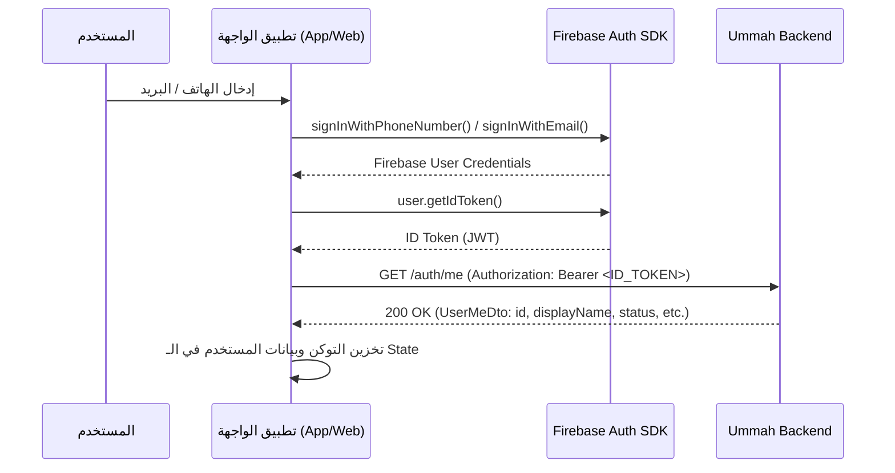
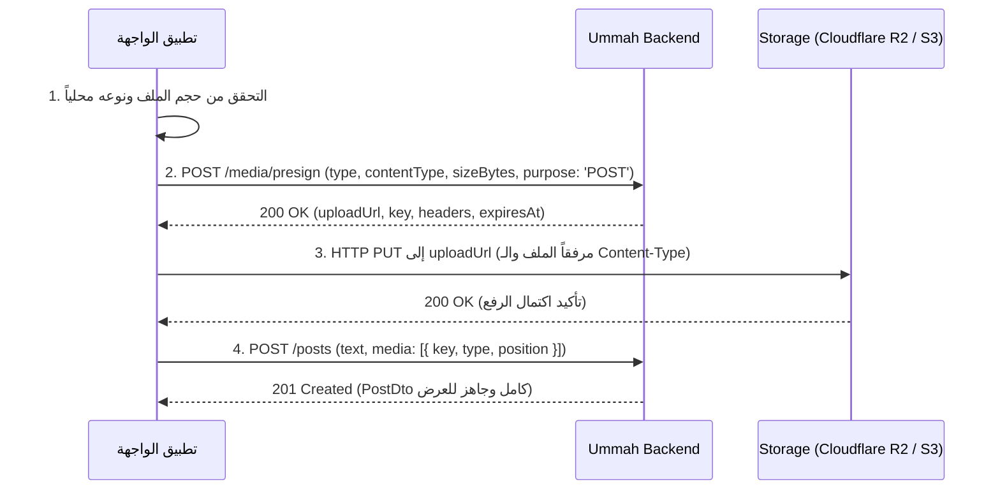

# دليل تكامل الواجهة الأمامية الشامل — Ummah App Backend V1
## Frontend Developer Integration & API Specification Guide

> **الهدف من هذا الدليل:** توفير مرجع حاسم وشامل لمهندسي الواجهة الأمامية (Web / Mobile)، يوضح بدقة **ما يجب بناؤه** و**ما يُمنع بناؤه في V1** لتجنب إهدار الوقت، مع شرح تفصيلي لدورات العمل (Workflows)، وهيكل البيانات، والتعامل مع الأخطاء، وكيفية توليد كود الـ API والـ Types آلياً.

---

## 1. حدود النطاق الصارمة للنسخة الأولى (Scope Boundaries)

لضمان سرعة إطلاق النسخة الأولى (V1) بأعلى جودة واستقرار، تم حسم الميزات المتاحة والمؤجلة معمارياً:

### ✅ أولاً: ما هو متاح ويجب بناؤه في الفرونت إند (In-Scope V1)
1. **شاشة الدخول والمصادقة (Auth):**
   - تسجيل الدخول / إنشاء الحساب عبر Firebase SDK (رقم هاتف أو بريد إلكتروني).
   - إرسال الـ ID Token الناتج إلى السيرفر عبر `GET /auth/me`.
2. **شاشة الفيد العام (Chronological Feed):**
   - عرض المنشورات مرتبة زمنياً من الأحدث للأقدم.
   - تصفح غير محدود (Infinite Scroll) باستخدام الـ Keyset Cursor.
   - متاح للزوار (Guest) والمستخدمين المسجلين على حد سواء.
3. **شاشة إنشاء منشور جديد (Post Creation):**
   - كتابة نص (حتى 2000 حرف).
   - إرفاق وسائط: حتى 4 صور **أو** فيديو واحد فقط (حتى 60 ثانية و 50 ميجابايت)، ويُمنع الجمع بين الصور والفيديو في نفس البوست.
   - الرفع المباشر إلى التخزين السحابي عبر الروابط الموقعة (Presigned PUT URLs).
4. **شاشة تفاصيل المنشور (Single Post View):**
   - عرض المنشور ببيانات الكاتب الكاملة، النص، الوسائط مرتبة، وتاريخ النشر.
5. **شاشة البروفايل الشخصي وتعديل البيانات (Profile & Settings):**
   - عرض الملف الشخصي للمستخدم الحالي.
   - تعديل الاسم (DisplayName حتى 50 حرف)، النبذة (Bio حتى 160 حرف)، ورفع وتغيير الصورة الشخصية (Avatar).
   - استعراض منشورات المستخدم الشخصية (تشمل المنشورات المخفية `HIDDEN` الخاصة به لمراجعتها).
6. **شاشة الملف الشخصي لأي مستخدم عام (Public Profile):**
   - عرض الاسم والنبذة والصورة الشخصية لأي مستخدم نشط.
   - عرض المنشورات النشطة فقط (`ACTIVE`) الخاصة بهذا الكاتب.
7. **إدارة المنشورات (لصاحب المنشور فقط):**
   - تعديل نص المنشور (`PATCH /posts/:id`) — متاح فقط إذا كان المنشور نشطاً (`ACTIVE`).
   - حذف المنشور (`DELETE /posts/:id`) — حذف آمن (Soft Delete).
8. **نظام الإبلاغ والمودال (Reporting):**
   - زر إبلاغ على كل منشور يفتح مودال لاختيار سبب من 4 أسباب محددة:
     - `RELIGIOUS_VIOLATION` (مخالفة دينية / قيمية)
     - `VIOLENCE` (عنف أو محتوى خطر)
     - `SPAM` (محتوى مزعج / إعلاني)
     - `OTHER` (سبب آخر)
9. **شاشة الحساب المعلق (Account Suspended Screen):**
   - إذا تم تعليق حساب المستخدم وتلقى التطبيق خطأ `403 ACCOUNT_SUSPENDED`، يتم إظهار شاشة توضح أن الحساب موقوف لمخالفته المعايير وتمنعه من إرسال طلبات.

---

### ❌ ثانياً: ما هو ممنوع بناؤه في الفرونت إند في V1 (Strictly Out-of-Scope)
> ⚠️ **تنبيه حاسم:** هذه الميزات غير مدعومة في الباك إند للنسخة الأولى عمداً لتجنب الـ Over-Engineering؛ رجاءً **عدم بناء واجهات لها أو وضع أزرار وهمية لها:**
- ❌ **لا توجد إعجابات أو تفاعلات (No Likes / Hearts / Reactions):** لا تضع زر قلب أو Like.
- ❌ **لا توجد تعليقات أو ردود (No Comments / Replies):** لا تضع صندوق تعليقات أسفل البوست.
- ❌ **لا توجد متابعة للحسابات (No Follow / Unfollow):** لا تضع زر "متابعة" في بروفايل المستخدمين.
- ❌ **لا توجد رسائل خاصة أو شات (No Direct Messages / Chat):** لا توجد غرف محادثة.
- ❌ **لا توجد شاشة إشعارات (No Notifications Screen):** لا توجد خدمة Push Notifications في V1.
- ❌ **لا توجد لوحة تحكم ويب للمشرفين (No Admin Dashboard):** الرقابة تتم إدارياً عبر الـ Runbook.

---

## 2. دورات العمل الأساسية للواجهة (Core Client Workflows)

### 🔄 دورة العمل 1: تسجيل الدخول وتهيئة المستخدم (Auth & JIT Provisioning)

- **القاعدة:** السيرفر يقوم بـ Auto-Provisioning للمستخدم الجديد تلقائياً في أول استدعاء لـ `GET /auth/me`.
- **التعامل مع التوكن:** يُرسل التوكن دائماً في الـ Header:
  `Authorization: Bearer <ID_TOKEN>`

---

### 🔄 دورة العمل 2: الرفع المباشر للوسائط ونشر البوست (Direct Media Upload Workflow)
> ⚠️ **القاعدة الذهبية:** السيرفر **لا يستقبل أي ملفات ميديا نهائياً** في الذاكرة. الرفع يتم مباشرة من جهاز المستخدم إلى سحابة التخزين (Cloudflare R2 / S3) عبر رابط موقع ومحدد الصلاحية (Presigned URL).



#### حدود التحقق من الميديا في الفرونت إند:
- **الصور:** الصيغ المدعومة (`image/jpeg`, `image/png`, `image/webp`). الحجم الأقصى: **5 ميجابايت** لكل صورة.
- **الفيديو:** الصيغ المدعومة (`video/mp4`, `video/quicktime`). الحجم الأقصى: **50 ميجابايت**، والمدة القصوى: **60 ثانية**.
- **الخلط الممنوع:** المنشور يقبل من 1 إلى 4 صور **أو** فيديو واحد فقط. محاولة إرسال صورة وفيديو معاً تُرفض فوراً بـ `400 INVALID_MEDIA_COMBINATION`.

---

### 🔄 دورة العمل 3: التصفح اللانهائي والتحديث (Keyset Infinite Scroll)
تعتمد المنصة على تقنية **Keyset Pagination** بدلاً من الـ Page/Offset القديم لضمان سرعة فائقة وعدم تكرار أو انزياح المنشورات:

1. **التحميل الأولي:**
   - استدعاء `GET /feed?limit=20` (افتراضياً 20 منشوراً).
   - الاستجابة تحتوي على:
     ```json
     {
       "items": [ /* مصفوفة المنشورات */ ],
       "nextCursor": "eyJjIjoiMjAyNi0xMC0yNV...iOiIxMjMifQ"
     }
     ```
2. **عند وصول المستخدم لأسفل الشاشة (Scroll Near Bottom):**
   - إذا كان `nextCursor !== null`:
     - استدعاء `GET /feed?limit=20&cursor=<nextCursor>`.
     - إضافة العناصر الجديدة لنهاية القائمة الحالية، وتحديث الـ `nextCursor`.
   - إذا كان `nextCursor === null`:
     - هذا يعني وصول المستخدم لآخر منشور في المنصة؛ توقف عن إرسال طلبات إضافية.
3. **عند السحب لأسفل للتحديث (Pull-to-Refresh):**
   - استدعاء `GET /feed?limit=20` (بدون تمرير أي cursor).
   - استبدال القائمة كاملة بالبيانات الجديدة.
4. **ملاحظة الأمان (Token Immunity):**
   - مسار الفيد عام؛ إذا كان المستخدم زائراً، لا ترسل ترويسة Authorization. إذا كان مسجلاً أرسلها، ولكن حتى لو كان التوكن منتهي الصلاحية سيعود الفيد بـ 200 طبيعي ولن يتعطل التطبيق.

---

### 🔄 دورة العمل 4: تعديل وحذف المنشور
- **تعديل المنشور (`PATCH /posts/:id`):**
  - متاح فقط لتعديل النص (`text`). الوسائط المرفوعة مسبقاً غير قابلة للتعديل أو الاستبدال بعد النشر.
  - إذا كان المنشور مخفياً بسبب البلاغات (`HIDDEN`) يرفض السيرفر التعديل بكود `409 POST_NOT_EDITABLE`.
- **حذف المنشور (`DELETE /posts/:id`):**
  - حذف آمن، يرجع السيرفر كود `204 No Content`.
  - قم بإزالة المنشور فوراً من الواجهة والقائمة المحلية.

---

### 🔄 دورة العمل 5: الإبلاغ عن المحتوى (Report Post)
- إرسال طلب `POST /posts/:id/report` مع كائن:
  ```json
  { "reason": "SPAM" }
  ```
- **حالات الاستجابة وكيفية التعامل معها في الواجهة:**
  - `201 Created`: إظهار Toast للمستخدم: *"شكراً لك، تم استلام بلاغك وسيقوم النظام بمراجعته."*
  - `403 CANNOT_REPORT_OWN_POST`: Toast: *"لا يمكنك الإبلاغ عن منشورك الخاص."*
  - `409 ALREADY_REPORTED`: Toast: *"لقد قمت بالإبلاغ عن هذا المنشور مسبقاً."*
  - `429 TOO_MANY_REQUESTS`: Toast: *"لقد تجاوزت الحد المسموح به للبلاغات، يرجى المحاولة بعد قليل."*

---

## 3. مرجع نقاط النهاية الكامل (Complete API Endpoints Matrix)

الرابط الأساسي أثناء التطوير المحلي: `http://localhost:3000`

| المسار | الطريقة | الصلاحية المطلوبة | ملخص الوظيفة | كود النجاح |
| :--- | :--- | :--- | :--- | :--- |
| `/health` | `GET` | عام (Public) | فحص سلامة السيرفر والداتابيز | `200` |
| `/auth/me` | `GET` | إلزامي (Bearer Token) | جلب بيانات المستخدم الحالي أو تسجيله التلقائي | `200` |
| `/users/me` | `PATCH` | إلزامي (Bearer Token) | تحديث الاسم، النبذة، أو مفتاح الصورة الشخصية | `200` |
| `/users/:id` | `GET` | عام (Public) | عرض بروفايل أي مستخدم عام | `200` |
| `/users/:id/posts` | `GET` | عام (Public) | جلب منشورات بروفايل محدد مع دعم Pagination | `200` |
| `/media/presign` | `POST` | إلزامي (Bearer Token) | توليد رابط موقع ومفتاح لرفع صورة أو فيديو | `200` |
| `/posts` | `POST` | إلزامي (Bearer Token) | إنشاء منشور جديد بنص و/أو وسائط | `201` |
| `/posts/:id` | `GET` | عام (Public) | جلب تفاصيل منشور محدد | `200` |
| `/posts/:id` | `PATCH` | إلزامي (صاحب البوست) | تعديل نص المنشور فقط | `200` |
| `/posts/:id` | `DELETE` | إلزامي (صاحب البوست) | حذف المنشور (Soft Delete) | `204` |
| `/feed` | `GET` | عام (Public) | الفيد العام التراكمي مرتباً زمنياً | `200` |
| `/posts/:id/report` | `POST` | إلزامي (Bearer Token) | إرسال بلاغ على منشور مخالف | `201` |

---

## 4. نموذج وهيكل البيانات المعادة (Response Data Shapes)

### كائن المنشور (PostDto)
```typescript
export interface PostDto {
  id: string;                    // UUID
  text: string | null;           // نص المنشور (أو null إذا كان وسائط فقط)
  status: 'ACTIVE' | 'HIDDEN';   // الحالة
  createdAt: string;             // ISO-8601 UTC
  author: {
    id: string;                  // UUID
    displayName: string;         // الاسم الظاهر
    avatarUrl: string | null;    // رابط الصورة الشخصية الكامل أو null
  };
  media: Array<{
    id: string;                  // UUID
    type: 'IMAGE' | 'VIDEO';     // نوع الميديا
    url: string;                 // رابط المشاهدة الكامل الجاهز للـ Image/Video tag
    position: number;            // الترتيب (0, 1, 2, 3)
  }>;
}
```

### كائن المستخدم الشخصي (UserMeDto)
```typescript
export interface UserMeDto {
  id: string;                    // UUID
  displayName: string;           // الاسم الظاهر
  bio: string | null;            // النبذة التعريفية
  avatarUrl: string | null;      // رابط الصورة الكامل
  status: 'ACTIVE' | 'SUSPENDED';// حالة الحساب
  createdAt: string;             // ISO-8601
}
```

### كائن الصفحة (Page<T>)
```typescript
export interface Page<T> {
  items: T[];                    // عناصر الصفحة الحالية
  nextCursor: string | null;     // الكيرسور للصفحة التالية (null تعني نهاية البيانات)
}
```

---

## 5. ميثاق معالجة الأخطاء الموحد (Error Handling Contract)

جميع استجابات الأخطاء من السيرفر تأتي بهيكل ثابت وموحد:
```json
{
  "statusCode": 400,
  "code": "VALIDATION_ERROR",
  "message": "text must be shorter than or equal to 2000 characters"
}
```

### جدول أكواد الأخطاء والإجراء المطلوب في الواجهة:
| HTTP Status | Error Code | المعنى | الإجراء في الفرونت إند |
| :--- | :--- | :--- | :--- |
| `400` | `VALIDATION_ERROR` | خطأ في صحة البيانات المدخلة | إظهار نص الخطأ في الحقل المناسب أو عبر Toast |
| `400` | `INVALID_CURSOR` | الكيرسور المرسل تالف أو غير صالح | إعادة طلب الصفحة الأولى من البداية بدون كيرسور |
| `400` | `EMPTY_POST` | محاولة نشر بوست بدون نص وبدون ميديا | تنبيه المستخدم بضرورة كتابة نص أو إرفاق وسائط |
| `400` | `INVALID_MEDIA_COMBINATION` | محاولة جمع صور وفيديو معاً | منع اختيار فيديو مع صور في الواجهة قبل الإرسال |
| `401` | `UNAUTHENTICATED` | الطلب يتطلب توكن ولم يُرسل | توجيه المستخدم لشاشة تسجيل الدخول |
| `401` | `INVALID_TOKEN` | التوكن المرسل منتهي أو غير صالح | تحديث التوكن عبر Firebase SDK وإعادة المحاولة |
| `403` | `ACCOUNT_SUSPENDED` | حساب المستخدم معلق بسبب البلاغات | توجيه المستخدم لشاشة "الحساب موقوف" |
| `403` | `CANNOT_REPORT_OWN_POST` | المستخدم حاول الإبلاغ عن منشوره | تنبيه المستخدم بمنع الإبلاغ الذاتي |
| `404` | `POST_NOT_FOUND` | المنشور غير موجود أو محذوف أو مخفي | إزالة المنشور من الواجهة أو إظهار "المحتوى غير متاح" |
| `404` | `USER_NOT_FOUND` | البروفايل غير موجود أو محظور | إظهار "المستخدم غير موجود" |
| `409` | `ALREADY_REPORTED` | تم الإبلاغ عن هذا البوست مسبقاً | إغلاق المودال وتنبيه المستخدم بوجود بلاغ سابق |
| `409` | `POST_NOT_EDITABLE` | محاولة تعديل بوست غير نشط | إغلاق شاشة التعديل وإبلاغ المستخدم بعدم إمكانية التعديل |
| `413` | `PAYLOAD_TOO_LARGE` | حجم الـ JSON المرسل يتجاوز 100kb | فحص حجم البيانات والتأكد من عدم إرسال Base64 في الـ JSON |
| `429` | `TOO_MANY_REQUESTS` | تجاوز معدل الطلبات المسموح (Throttling) | إظهار رسالة انتظر دقيقة وأعد المحاولة |

---

## 6. كيفية توليد أنواع الـ TypeScript والـ API Client آلياً

تم تصدير ملف مواصفات الـ OpenAPI الرسمي في المسار:
📂 `docs/openapi-spec.json`

بإمكان مطور الواجهة استخدام أداة سريعة ومجانية لتوليد كافة الـ Interfaces في الفرونت إند بضغطة زر واحدة:

### عبر `openapi-typescript` (موصى بها لأي مشروع React / Next.js / Vue):
```bash
npx openapi-typescript docs/openapi-spec.json -o src/types/api.d.ts
```

### عبر `orval` (لتوليد React Query Hooks كاملة مع الأنواع):
```bash
npx orval --input docs/openapi-spec.json --output src/api/generated.ts
```

---

## 7. ملخص سريع لإعداد بيئة التطوير للفرونت إند:
1. تأكد من تشغيل الباك إند: `npm run start:dev`.
2. يمكنك ملء قاعدة البيانات ببيانات تجريبية عبر تشغيل:
   ```bash
   npm run seed
   ```
3. افتح التوثيق التفاعلي لمعاينة المسارات وتجربتها مباشرة:
   👉 `http://localhost:3000/docs`
