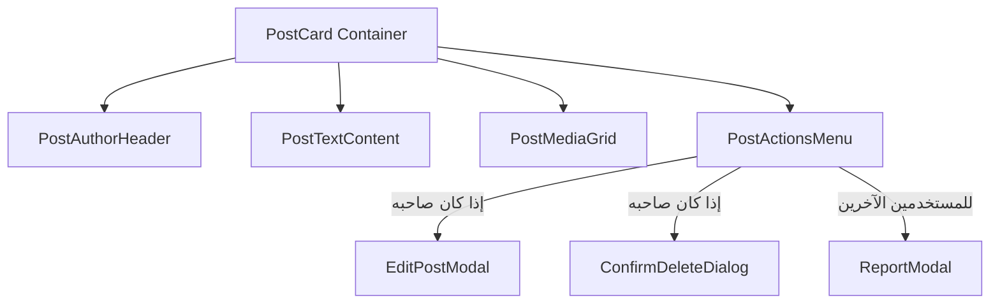

# المخطط المعماري الشامل للصفحات والمكونات في الواجهة الأمامية
## Frontend Pages, Routing & Component Architecture — Ummah Platform V1

> **المنهجية الهندسية:** معايير كبير المهندسين (Staff / Principal Frontend Architect — 30+ Years Experience)  
> **القواعد الذهبية الصارمة:**
> 1. **سقف الـ 250 سطراً (Hard Limit 250 LOC):** يُمنع منعاً باتاً أن يتجاوز أي ملف في المشروع 250 سطراً. أي مكون يكبر يتم تفكيكه فورياً إلى Sub-components أو Custom Hooks.
> 2. **قاعدة إعادة الاستخدام (Rule of 2+):** أي عنصر تصميمي أو منطقي يتكرر مرتين فأكثر، يُعزل حتماً كمكون مستقل في `src/components/ui/`.
> 3. **قاعدة الفصل أحادي الاستخدام (Rule of 1):** أي عنصر مستخدم مرة واحدة لكنه يحتوي على أكثر من 80 سطراً أو منطق معالجة مستقل (مثل محدد الوسائط، مودال البلاغات، شبكة الصور) يُعزل في مكون مستقل لتسريع القراءة والتطوير ومنع إعادة الرسم العشوائي (Re-render Optimization).
> 4. **منع الـ Over-Engineering:** بنية Feature-Based نقية وسهلة الصيانة، تدعم التوسع المستقبلي لـ V2 دون أي تعقيد زائد.

---

## 1. شجرة ملفات المشروع المعمارية (Architecture Tree)

```text
src/
├── app/                        # توجيه الصفحات (Next.js App Router أو React Router)
│   ├── layout.tsx              # الإطار العام، Navbar، Bottom Nav، Toast Provider (< 120 LOC)
│   ├── page.tsx                # صفحة الفيد العام الرئيسية (FeedPage) (< 90 LOC)
│   ├── login/page.tsx          # صفحة الدخول (LoginPage) (< 110 LOC)
│   ├── posts/[id]/page.tsx     # صفحة تفاصيل المنشور (PostDetailPage) (< 130 LOC)
│   ├── profile/page.tsx        # صفحة بروفايلي الشخصي (MyProfilePage) (< 140 LOC)
│   ├── users/[id]/page.tsx     # صفحة بروفايل أي مستخدم (UserProfilePage) (< 120 LOC)
│   ├── suspended/page.tsx      # صفحة الحساب الموقوف (SuspendedPage) (< 80 LOC)
│   └── not-found.tsx           # صفحة 404 (< 60 LOC)
├── components/
│   ├── ui/                     # مكونات الذرة العامة (Atoms - كلها قابلة لإعادة الاستخدام)
│   │   ├── Button.tsx          # أزرار بمتغيرات وأحجام وحالة تحميل (< 90 LOC)
│   │   ├── Input.tsx           # حقل إدخال نصوص مع رسائل التحقق (< 70 LOC)
│   │   ├── Textarea.tsx        # حقل نصي يتمدد تلقائياً مع عداد الحروف (< 80 LOC)
│   │   ├── Avatar.tsx          # صورة المستخدم مع الحرف الأول كـ Fallback (< 65 LOC)
│   │   ├── Modal.tsx           # نافذة منبثقة داعمة للـ Accessibility (< 100 LOC)
│   │   ├── Toast.tsx           # تنبيهات الأخطاء والنجاح (< 85 LOC)
│   │   ├── Badge.tsx           # شارات الحالات (نشط، مخفي، معلق) (< 40 LOC)
│   │   ├── Skeleton.tsx        # وميض التحميل (Shimmer Placeholders) (< 55 LOC)
│   │   └── DropdownMenu.tsx    # قائمة خيارات البوست المنبثقة (< 95 LOC)
│   └── common/                 # مكونات تخطيط الموقع
│       ├── Navbar.tsx          # الشريط العلوي (< 90 LOC)
│       ├── BottomNav.tsx       # الشريط السفلي للموبايل (< 80 LOC)
│       └── EmptyState.tsx      # شاشة الفراغ عندما لا توجد منشورات (< 50 LOC)
└── features/                   # موديولات الميزات الموجهة بمجال العمل (Feature Slices)
    ├── auth/                   # ميزة المصادقة
    │   ├── LoginForm.tsx       # نموذج إدخال الهاتف/البريد (< 110 LOC)
    │   └── OtpInput.tsx        # مربعات إدخال كود التحقق (< 90 LOC)
    ├── feed/                   # ميزة الفيد العام
    │   ├── FeedList.tsx        # قائمة الفيد مع IntersectionObserver (< 120 LOC)
    │   └── PullToRefresh.tsx   # حاوية السحب للتحديث على الموبايل (< 100 LOC)
    ├── posts/                  # ميزة المنشورات
    │   ├── PostCard.tsx        # بطاقة المنشور المتكاملة (< 130 LOC)
    │   ├── PostAuthorHeader.tsx# رأس البوست: اسم الكاتب، صورته، الوقت (< 75 LOC)
    │   ├── PostMediaGrid.tsx   # شبكة عرض الصور (1-4) أو الفيديو (< 140 LOC)
    │   ├── PostActionsMenu.tsx # زر النقاط الثلاث (تعديل، حذف، إبلاغ) (< 85 LOC)
    │   ├── CreatePostCard.tsx  # صندوق إنشاء المنشور المختصر في الفيد (< 90 LOC)
    │   ├── CreatePostModal.tsx # نافذة إنشاء المنشور المتكاملة (< 160 LOC)
    │   ├── MediaUploader.tsx   # محدد ومعاين الصور والفيديو مع الفحص (< 180 LOC)
    │   └── EditPostModal.tsx   # نافذة تعديل نص المنشور (< 110 LOC)
    ├── users/                  # ميزة البروفايل
    │   ├── ProfileHeader.tsx   # هيدر البروفايل (الاسم، النبذة، الأفاتار) (< 110 LOC)
    │   └── EditProfileModal.tsx# نافذة تعديل الاسم والنبذة ورفع الصورة (< 150 LOC)
    └── moderation/             # ميزة الرقابة
        └── ReportModal.tsx     # مودال الإبلاغ واختيار الأسباب الأربعة (< 130 LOC)
```

---

## 2. جدول ومسارات الصفحات بالكامل (Complete Pages & Routes Matrix)

| # | اسم الصفحة | المسار (Route) | نوع الوصول | وصف الصفحة ومكوناتها الأساسية |
| :--- | :--- | :--- | :--- | :--- |
| **1** | `FeedPage` | `/` أو `/feed` | عام (Public) | **الصفحة الرئيسية:** تعرض الفيد العام التراكمي مرتباً زمنياً مع التمرير اللانهائي والسحب للتحديث وصندوق إنشاء بوست سريع بالأعلى. |
| **2** | `LoginPage` | `/login` | زوار فقط (Guest) | **شاشة الدخول:** إدخال رقم الهاتف أو البريد، استلام OTP، والاتصال بـ Firebase ثم `GET /auth/me`. |
| **3** | `PostDetailPage` | `/posts/:id` | عام (Public) | **عرض تفاصيل منشور مفرد:** فتح المنشور برابط مباشر مع عرض الوسائط بدقة كاملة وخيارات المشاركة والإبلاغ. |
| **4** | `CreatePostPage` / `Modal` | زر عائم أو `/new-post` | مسجلين فقط (Auth) | **إنشاء بوست:** محرر نصوص (2000 حرف)، محدد وسائط (حتى 4 صور أو 1 فيديو)، وشريط تقدم الرفع. |
| **5** | `MyProfilePage` | `/profile` أو `/me` | مسجلين فقط (Auth) | **ملفي الشخصي:** عرض بياناتي، زر "تعديل البروفايل"، وتبويبان: "منشوراتي النشطة" و"منشوراتي قيد المراجعة (Hidden)". |
| **6** | `UserProfilePage` | `/users/:id` | عام (Public) | **بروفايل أي كاتب:** عرض اسمه، نبذته، أفتاره، وقائمة منشوراته النشطة فقط `ACTIVE`. |
| **7** | `SuspendedPage` | `/suspended` | محظورين فقط | **صفحة تنبيه الحساب المعلق:** تظهر فور تلقي خطأ `403 ACCOUNT_SUSPENDED` لتوضيح سبب الحظر والتواصل مع الدعم. |
| **8** | `NotFoundPage` | `*` أو `/404` | عام (Public) | **صفحة 404:** واجهة جذابة توضح أن المحتوى غير موجود وزر عودة للرئيسية. |

---

## 3. تفكيك وهندسة المكونات المعقدة (Deep Component Decomposition)

### 3.1 بطاقة المنشور (`PostCard.tsx` — 130 LOC)
تُقسم هندسياً إلى 4 مكونات جزئية مستقلة لضمان ألا يتجاوز أي ملف 150 سطراً ولمنع إعادة رسم البطاقة بالكامل:
1. `PostAuthorHeader.tsx`: يعرض الأفاتار، الاسم، والوقت النسبي (منذ دقيقتين، منذ ساعة).
2. `PostText.tsx`: يعرض النص مع دعم الروابط والـ Show More إذا زاد عن 4 أسطر.
3. `PostMediaGrid.tsx`: يتكيف بذكاء لعرض:
   - صورة واحدة (Full width).
   - صورتان (جانباً إلى جنب 50%/50%).
   - 3 صور (واحدة كبيرة واثنتان صغيرتان).
   - 4 صور (شبكة 2x2 متناسقة).
   - أو مشغل فيديو مدمج مع تحكم بالصوت.
4. `PostActionsMenu.tsx`: قائمة ثلاثية النقاط تظهر خيارات (تعديل/حذف) لصاحب المنشور فقط، وخيار (إبلاغ) للآخرين.



---

### 3.2 محدد ورافع الوسائط (`MediaUploader.tsx` — 180 LOC)
يحتوي على فحص محلي صارم قبل أي استدعاء للسيرفر:
* **فحص الصور:** الحد الأقصى 4 صور، نوع MIME (`image/jpeg`, `image/png`, `image/webp`)، وحجم لا يتجاوز 5MB لكل صورة.
* **فحص الفيديو:** فيديو واحد فقط، نوع MIME (`video/mp4`, `video/quicktime`)، وحجم لا يتجاوز 50MB، والمدة الزمنية لا تتجاوز 60 ثانية (تُفحص عبر عنصر `HTMLVideoElement` محلياً قبل الرفع).
* **معاينة حية (Thumbnail Preview):** إمكانية إزالة أي صورة بنقرة زر `(x)` قبل الرفع.

---

### 3.3 نافذة الإبلاغ (`ReportModal.tsx` — 130 LOC)
* قائمة راديو (Radio Group) بالأسباب الأربعة المعتمدة حصراً:
  1. `RELIGIOUS_VIOLATION` (مخالفة دينية أو قيمية)
  2. `VIOLENCE` (عنف أو أذى)
  3. `SPAM` (محتوى مكرر أو احتيالي)
  4. `OTHER` (سبب آخر)
* عند الإرسال: تفعيل الـ Spinner لمنع الضغط المزدوج.
* عند عودة 201: إغلاق المودال وإظهار Toast نجاح.
* عند عودة 409: إظهار Toast: *"لقد قمت بالإبلاغ عن هذا المنشور مسبقاً."*

---

## 4. استراتيجية الأداء والسرعة (Speed & Performance Optimization)

1. **الـ Keyset Virtualization:**
   - في الفيد العام، عند تجاوز عدد المنشورات 50 منشوراً في الذاكرة، يتم تفعيل Virtual Scrolling (عبر `@tanstack/react-virtual` أو تفريغ الـ DOM غير المرئي) لضمان ثبات معدل الإطارات عند 60fps على الهواتف الضعيفة.
2. **تحسين تحميل الصور (Next-Gen Images):**
   - استخدام صيغ `WebP` مع `loading="lazy"` وترويسة `srcset` لتقليل استهلاك باقة الإنترنت.
3. **التحميل الكسول للمودالات (Code-Splitting):**
   - تحميل نافذة `CreatePostModal` و `ReportModal` و `EditProfileModal` عبر `React.lazy()` أو Dynamic Import، بحيث لا يتم تحميل كودها في الـ Bundle الأساسي إلا عند نقر المستخدم على الزر.

---

## 5. ميثاق الاختبارات للواجهة (Frontend Testing Blueprint)

| نوع الاختبار | الأداة | الملفات المستهدفة | الهدف |
| :--- | :--- | :--- | :--- |
| **Unit Tests** | Vitest | `src/hooks/*.ts`, `src/utils/*.ts` | اختبار هوكات الـ Pagination، وفحص حجم الفيديو، وصيغ التواريخ. |
| **Component Tests** | React Testing Library | `PostCard.test.tsx`, `MediaUploader.test.tsx` | اختبار ظهور أزرار التعديل والحذف للصاحب فقط، وحظر اختيار صور مع فيديو. |
| **E2E Smoke Tests** | Playwright | `feed.spec.ts`, `auth.spec.ts` | اختبار تدفق تسجيل الدخول وتصفح الفيد وإنشاء بوست بنجاح. |

---

## 6. قواعد النظافة المعمارية للتطوير (Clean Code Golden Rules)
1. **قاعدة الـ Single Responsibility:** كل ملف يقوم بوظيفة واحدة فقط (الملف لا يجمع بين التصميم واستدعاء الشبكة وإدارة الكاش).
2. **قاعدة منع الـ Magic Numbers:** استخدام الثوابت المركزية:
   `MAX_POST_TEXT = 2000`, `MAX_IMAGES = 4`, `MAX_VIDEO_SECONDS = 60`, `MAX_IMAGE_BYTES = 5242880`.
3. **قاعدة حظر الـ Any:** الالتزام الصارم بـ TypeScript Strict Mode دون أي `any`.
